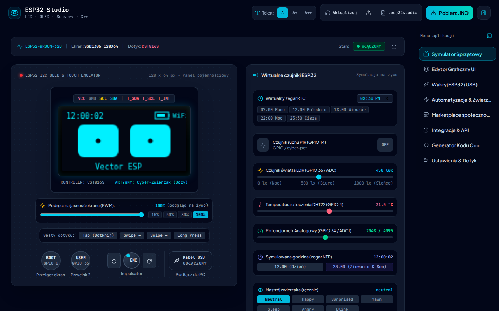
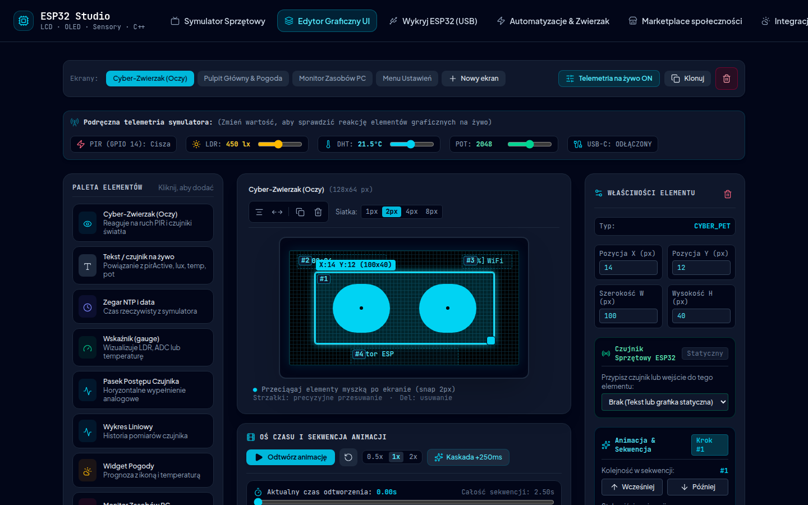
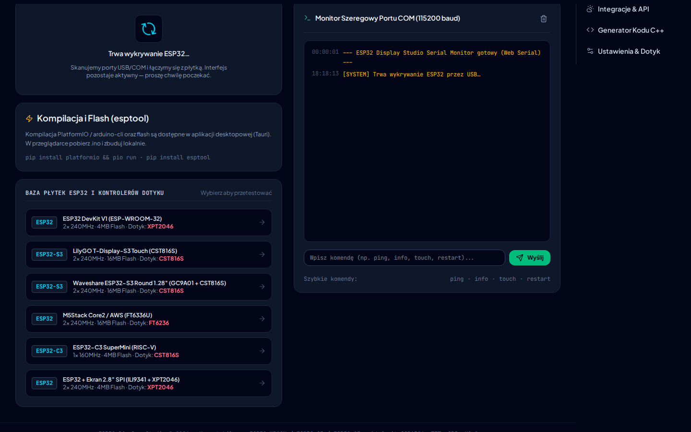
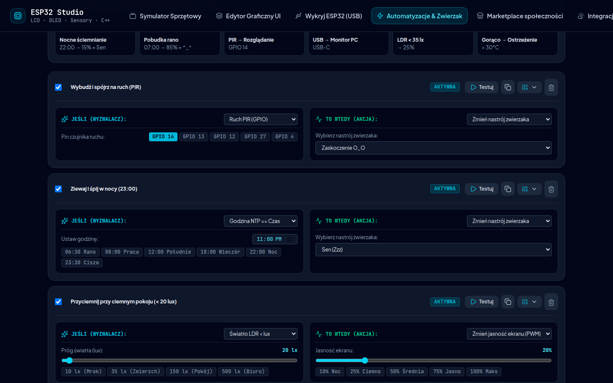
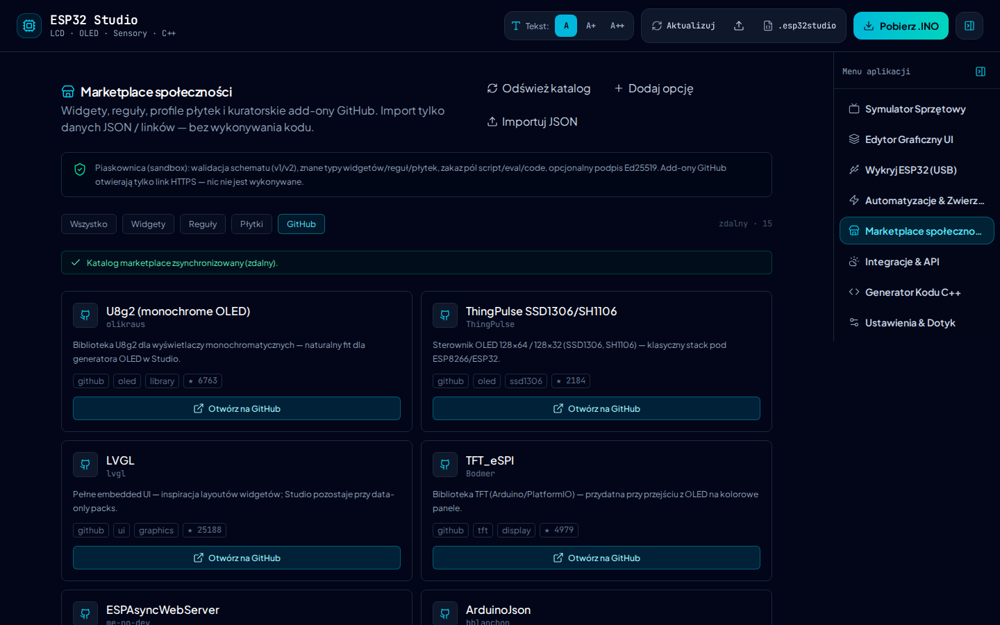
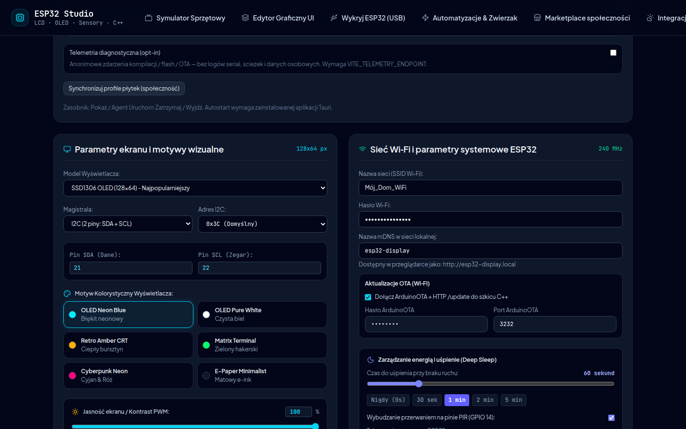
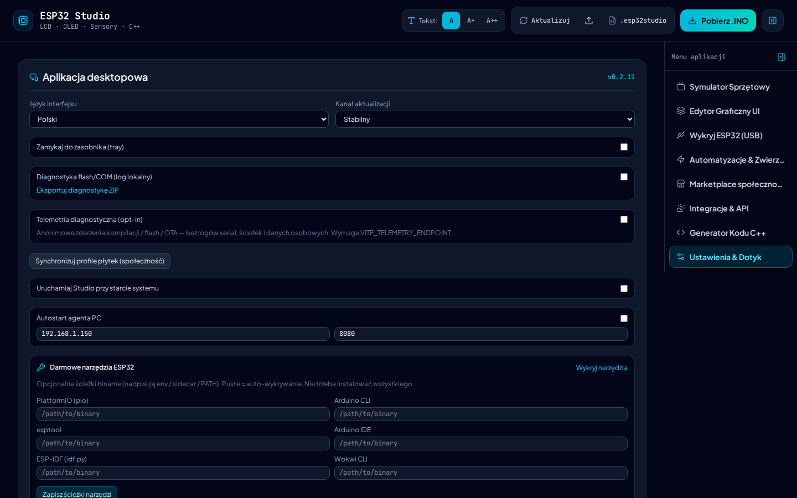
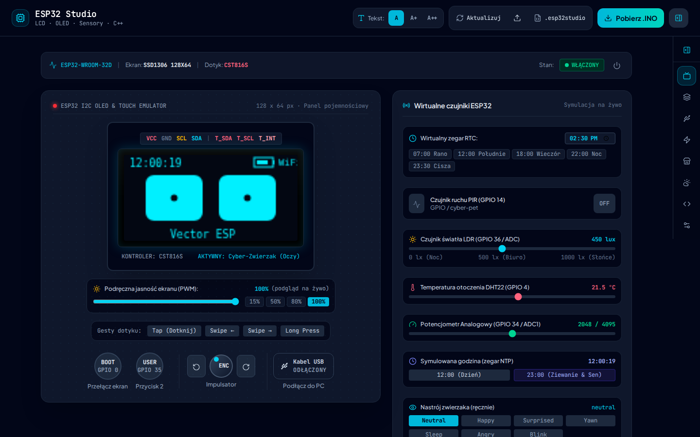

# ESP32 Display Studio

[](https://github.com/mateowoj-cpu/ESP32-App/actions/workflows/smoke.yml)
[](./package.json)
[](./src-tauri/)
[](./src/i18n/)

**Wizualne studio UI OLED/LCD dla ESP32** — React/Vite frontend + shell **Tauri 2** (Rust): symulator sprzętu, edytor ekranów, automatyzacje, serial USB (Web Serial / natywny COM), Build → Flash → OTA (esptool / espota / mDNS), marketplace JSON (sandbox), agent PC i generator C++ (Arduino / PlatformIO).

Repozytorium: [mateowoj-cpu/ESP32-App](https://github.com/mateowoj-cpu/ESP32-App) · Linia **0.2.13** (Fazy 0–17 + multi-OS CI + UX/pinout/peripherals + Windows bez migających CMD) · Następna: [Faza 18 ops](./docs/roadmap-next.md)

> **EN:** Design ESP32 OLED/LCD UIs visually, preview hardware, generate Arduino/PlatformIO firmware, and on desktop flash over USB or OTA Wi‑Fi through a Tauri 2 shell with platform adapters in `src/platform/`.

## Spis treści

- [Stack](#stack)
- [Szybki start](#szybki-start)
- [Macierz build / release](#macierz-build--release)
- [Kluczowe funkcje](#kluczowe-funkcje)
- [Dokumentacja](#dokumentacja)
- [Wymagania](#wymagania)
- [Desktop (Tauri) — skrót techniczny](#desktop-tauri--skrót-techniczny)
- [Status i roadmapa](#status-i-roadmapa)
- [Contributing](#contributing)
- [Screenshots](#screenshots)

## Stack

| Warstwa | Technologia |
|---------|-------------|
| UI | React 19, Vite 8, Tailwind 4, TypeScript, Motion, Lucide |
| i18n | `src/i18n` — PL / EN (`LocaleContext`, `locales.ts`) |
| Platform JS | `src/platform/*` — serial, flash, firmwareBuild, ota, desktop, updater, diagnostics, telemetry, marketplace, board\* |
| Desktop | Tauri **2** (`src-tauri/`, Rust 1.90+), pluginy: updater, deep-link, autostart, dialog, process, single-instance, tray |
| Serial native | crate `serialport` → komendy `list/open/write/close_serial_port` |
| Flash / OTA | `esptool` (PATH), PlatformIO / arduino-cli, `espota.py`, HTTP `/update`, odkrywanie mDNS (`mdns-sd`) |
| Packaging | Windows NSIS+MSI; Linux AppImage+deb; macOS dmg (+ opcjonalny notarize) |
| CI | `smoke.yml`, `windows-release.yml`, `desktop-unix-release.yml`, `winget-draft.yml`, … |

Szczegóły warstw i IPC: [docs/architecture.md](./docs/architecture.md).

## Szybki start

### Web (Vite)

```bash
npm ci          # lub: npm install
npm run dev     # http://localhost:3000 — Web Serial w Chromium
```

### Desktop (Tauri)

```bash
npm ci
npm run tauri:dev       # natywne COMx / /dev/tty* / /dev/cu.*
npm run tauri:build     # instalator na bieżącym hoście (Windows → NSIS/MSI)
```

### Weryfikacja przed PR

```bash
npm run smoke           # lint + testy platform + board-catalog + vite build
npm run compile:full    # smoke + cargo check  (+ --release / --linux-bundle)
```

Pełny setup: [docs/developer-setup.md](./docs/developer-setup.md) · użytkownik: [docs/user-guide.md](./docs/user-guide.md).

### Skrypty `package.json` (źródło prawdy)

| Skrypt | Opis |
|--------|------|
| `dev` / `build` / `preview` | Vite (:3000 / produkcja) |
| `lint` | `tsc --noEmit` (include: `src/`, `scripts/**/*.ts`; bez `src-tauri/target`) |
| `clean` | `rimraf dist` |
| `smoke` | lint + `test:*` + `validate:board-catalog` + `build` |
| `compile:cargo` | `cargo check` w `src-tauri` |
| `compile:full` | `scripts/full-compile.sh` (smoke + cargo; flagi `--release`, `--linux-bundle`) |
| `tauri:dev` / `tauri:build` | Shell desktop |
| `tauri:build:windows` | Cross target `x86_64-pc-windows-msvc` (wymaga toolingu Windows) |
| `tauri:build:signed` | Build + lokalna nakładka Authenticode (`tauri.windows-signing.local.json`) |
| `test:serial` … `test:marketplace` | Unit testy platformy |
| `validate:board-catalog` | Walidacja `community.json` + offset↔chip + bundled parity |
| `pc-agent:test` | Smoke agenta Pythona |

## Macierz build / release

| Artefakt | Gdzie działa | Jak |
|----------|--------------|-----|
| Vite web (`dist/`) | każdy OS z Node 22 | `npm run build` / CI `smoke.yml` |
| Rust check | Linux/macOS/Windows + deps Tauri | `npm run compile:cargo` / job `rust-smoke` |
| Linux AppImage + deb | **Linux** host / CI | `npm run compile:full -- --linux-bundle` lub `tauri:build -- --config src-tauri/tauri.linux.json` |
| macOS dmg | **macOS** / CI | `tauri:build -- --config src-tauri/tauri.macos.json` |
| Windows NSIS / MSI | **Windows** + MSVC / CI | `npm run tauri:build` · workflow `windows-release.yml` (`workflow_dispatch` lub tag `v*`) |
| Linux AppImage + deb (CI) | `ubuntu-22.04` | `linux-release.yml` (osobno od macOS) |
| macOS dmg (CI) | `macos-14` | `macos-release.yml` (osobno od Linux) |
| Authenticode / Apple notarize / signed updater | sekrety **człowieka** | docs signing / macos-notarize / desktop-unix |
| winget | draft CI OK; live merge = human | `winget-draft.yml` + [windows-winget.md](./docs/windows-winget.md) |

Wersja: jedno źródło prawdy `package.json` → `tauri.conf.json` + `Cargo.toml` + root `package-lock.json` (`npm run assert:app-version`). Każdy OS release osobno — nie używaj Re-run na starym runie; szczegóły: [desktop-unix.md](./docs/desktop-unix.md).

**Ta Linux VM / agent cloud:** web smoke + `cargo check` / opcjonalnie AppImage+deb. **Nie:** NSIS/MSI, dmg/notarize, Authenticode — bez Windows/macOS hosta i sekretów.

## Kluczowe funkcje

| Obszar | Co dostajesz |
|--------|----------------|
| **Projektowanie** | Symulator OLED/LCD, edytor widgetów, sekwencje ekranów, mapa pinów |
| **Automatyzacje** | Triggery PIR / czas / dotyk / USB, cyber-zwierzak |
| **Marketplace** | Widget/rule packs + **board packs** + curated **GitHub add-ons**; formularz „Dodaj opcję”; sandbox JSON (v1/v2, Ed25519, bez `eval`) |
| **USB / serial** | Web Serial lub native (`serialport`); non-blocking **Wykryj ESP32** z banerem oczekiwania; board cache/sync |
| **Firmware** | Generator `.ino` + `platformio.ini`; Build-from-Studio (PIO / arduino-cli, PATH lub sidecar) |
| **Tooling** | Detekcja darmowych narzędzi: PlatformIO, Arduino CLI/IDE, esptool, ESP-IDF, Wokwi + override ścieżek |
| **Flash / OTA** | `esptool write_flash` na COM; OTA `espota` / HTTP + mDNS (`_arduino._tcp`, `_http._tcp`) |
| **Nawigacja** | Zwijane menu aplikacji po prawej (desktop `lg+`); preferencja w `localStorage` |
| **Desktop shell** | Tray, close-to-tray, autostart, deep link `esp32studio://`, pliki `.esp32studio` |
| **Agent PC** | CPU / RAM / dysk (/ GPU) → ESP32 (`tools/pc-agent`) |
| **Aktualizacje** | Kanały stable / beta (`latest.json` / `latest-beta.json`) |
| **i18n** | PL / EN (chrome + panele) |
| **Diagnostyka** | Lokalny log + ZIP; telemetria sieciowa **opt-in** (domyślnie off, wymaga `VITE_TELEMETRY_ENDPOINT`) |
| **Dystrybucja** | NSIS/MSI, szablony winget + draft CI, paczki Unix z CI |

## Dokumentacja

Indeks: **[docs/README.md](./docs/README.md)**

| Start | Temat |
|-------|--------|
| [Przewodnik użytkownika](./docs/user-guide.md) | Jak korzystać ze Studio |
| [Setup developera](./docs/developer-setup.md) | Środowisko, skrypty, CI, env, PR |
| [Architektura](./docs/architecture.md) | Moduły, IPC, przepływy serial/flash/OTA |
| [Roadmapa](./docs/roadmap-next.md) | Po board-catalog community validation → Faza 18 (ops / human) |

**Desktop / Windows:** [installer](./docs/windows-installer.md) · [drivers](./docs/windows-drivers.md) · [desktop](./docs/windows-desktop.md) · [updater](./docs/windows-updater.md) · [signing](./docs/windows-signing.md) · [SmartScreen](./docs/windows-smartscreen.md) · [winget](./docs/windows-winget.md) · [deep link](./docs/windows-deep-link.md) · [PC agent](./docs/windows-pc-agent.md) · [diagnostics](./docs/windows-diagnostics.md)

**Build / flash / OTA:** [tooling](./docs/esp32-tooling-integrations.md) · [build-flash](./docs/windows-build-flash.md) · [flash](./docs/windows-flash.md) · [sidecar PIO](./docs/windows-sidecar-pio.md) · [OTA](./docs/windows-ota.md)

**Unix, marketplace, privacy:** [desktop-unix](./docs/desktop-unix.md) · [macos-notarize](./docs/macos-notarize.md) · [board-catalog](./docs/board-catalog.md) · [marketplace API](./docs/marketplace-plugin-api.md) · [GitHub add-ons](./docs/marketplace-github-addons.md) · [publishers](./docs/marketplace-publishers.md) · [telemetry](./docs/telemetry.md)

## Wymagania

| Narzędzie | Wersja | Uwagi |
|-----------|--------|--------|
| Node.js | 22 LTS+ | [nodejs.org](https://nodejs.org/) |
| npm | 10+ | z Node |
| Chromium | aktualny | Web Serial w trybie web |
| Rust + C++ toolchain | stable (MSRV w `Cargo.toml`: 1.90) | tylko desktop Tauri |
| WebView2 | Win 10/11 | zwykle preinstalowany |
| Python 3 + pip | 3.10+ | sidecar PIO, esptool, agent PC |

### Windows — port COM

1. Node 22 LTS (Add to PATH), PowerShell / Windows Terminal.  
2. Przeglądarka **lub** shell Tauri (natywny COM bez Web Serial).  
3. W Menedżerze urządzeń musi być `COMx`:
   - **CH340 / CH9102** (`0x1A86`) — WCH  
   - **CP210x** (`0x10C4`) — Silicon Labs  
   - **Espressif USB** (`0x303A`, m.in. S3/C3) — zwykle CDC przez Windows Update  

Bez sterownika USB-UART ani przeglądarka, ani Tauri nie zobaczą urządzenia — [docs/windows-drivers.md](./docs/windows-drivers.md).

## Desktop (Tauri) — skrót techniczny

- Scaffold: `src-tauri/` (productName **ESP32 Display Studio**, id `studio.esp32.display`, v`0.2.13`).
- Bootstrap UI: `src/main.tsx` — jeśli `isTauri()`, dynamiczny import `nativeSerial` i `setSerialAdapter(...)` (web bundle nie ciągnie `@tauri-apps/api` eagerly).
- Warstwa JS: `src/platform/` — UI **nie** woła `navigator.serial` ani `invoke` poza adapterami.
- Komendy Rust (skrót): serial (`list/open/write/close_serial_port`), flash (`get_esptool_info`, `flash_write_firmware`, `read_open_file`), build (`get_firmware_toolchain_info`, `build_firmware_from_sketch`), OTA (`get_ota_tool_info`, `flash_ota_firmware`, `cancel_ota_firmware`, `discover_ota_hosts`), desktop/updater/diagnostics/pc-agent — pełna tabela w [architecture.md](./docs/architecture.md).
- Eventy: `serial-data`, `serial-disconnected`, `flash-log`, `build-log`, `ota-log`, `app-open-paths`.

### Agent PC

```bash
cd tools/pc-agent && pip install -r requirements.txt
python esp32_pc_agent.py --host 192.168.1.150 --port 8080
```

Windows `.exe`: `scripts/windows/Build-PcAgent.ps1`. W UI: **Integracje → Monitor PC**. Docs: [windows-pc-agent.md](./docs/windows-pc-agent.md).

### Firmware z Studio

1. Skonfiguruj UI / automatyzacje.  
2. Desktop: **USB → Build → Flash** (sidecar PIO lub PATH); OTA w tej samej zakładce.  
3. Albo eksport `.ino` z generatora i build w Arduino IDE / PlatformIO.

```powershell
powershell -File .\scripts\windows\Install-PlatformIoSidecar.ps1
# Unix:
# bash scripts/unix/install-platformio-sidecar.sh
```

### Zmienne środowiskowe

Skopiuj `.env.example` → `.env` przy potrzebie (Vite / build):

```text
GEMINI_API_KEY=...             # opcjonalny / obecnie nieużywany w UI
APP_URL=http://localhost:3000
# VITE_TELEMETRY_ENDPOINT=     # build-time; bez tego toggle telemetrii nic nie wysyła
```

Runtime (proces Tauri / sidecar — nie commituj ścieżek sekretnych):

| Zmienna | Rola |
|---------|------|
| `ESP32_STUDIO_PIO` | Pełna ścieżka do `pio` / `pio.exe` |
| `ESP32_STUDIO_ESPTOOL` | Pełna ścieżka do `esptool` / `esptool.py` |
| `ESP32_STUDIO_ESPOTA` | Pełna ścieżka do `espota.py` |
| `ESP32_STUDIO_DATA_DIR` | Katalog danych sidecar (Unix installer) |

Sekrety Authenticode / updater / winget / telemetry — wyłącznie GitHub Secrets lub lokalny sejf (komentarze w `.env.example`). **Nie inventuj** URL releasów, SHA256 ani wartości sekretów w docs.

## Status i roadmapa

| Faza | Skrót |
|------|--------|
| 0–5 | README Windows, Serial abstrakcja, Tauri COM, NSIS/MSI, agent PC, flash + deep link |
| 6–8 | Tray/autostart, i18n, kanały update, Build-from-Studio, winget template, diagnostyka |
| 9–11 | Sidecar PIO, OTA + mDNS, głębokie i18n, penv CI, winget path |
| **12** | SmartScreen checklist, ZIP diagnostyki, board sync, Unix parity (`0.2.5`) |
| **13** | CI AppImage/deb/dmg, opt-in telemetria, draft winget SHA, i18n pinout/USB (`0.2.6`) |
| **14** | Marketplace (JSON sandbox), EV/SmartScreen docs, board catalog, Unix polish (`0.2.7`) |
| **15** | Plugin API marketplace v2, live winget prep, telemetry ops, signed Unix updater (`0.2.8`) |
| **16** | Board catalog PR validation, identify i18n, EV HSM runner, macOS notarize CI (`0.2.9`) |
| **17** | Marketplace sandbox publisher + signed fixture packs (`0.2.10`) |
| **—** | Board catalog community PR flow + offset↔chip + bundled parity (po 0.2.10) |
| **closure** | `compile:full` / `scripts/full-compile.sh` + checklist w developer-setup |
| **0.2.11** | Multi-OS release CI (#34), winget draft harden (#35), USB detect UX (#36), marketplace board/GitHub (#37), free tooling (#38), right-side menu (#39), docs/screenshots (#40) |
| **0.2.12** | Shell clipping fix (#41), USB pinout + A3144 (#42), peripheral catalog (#43), version/CI/i18n gap closure (#44) |
| **0.2.13** | Windows: hide CMD flash on USB/Settings toolchain probes (`CREATE_NO_WINDOW`) |
| **18+** | Ops live winget/telemetry, EV/Apple secrets (human), live publishers |

Szczegóły: [docs/roadmap-next.md](./docs/roadmap-next.md).

**Uwaga dystrybucji:** draft winget i checklisty SmartScreen **nie** oznaczają live publish do `winget-pkgs` ani gotowej reputacji EV — to kroki człowieka po signed release.

## Contributing

1. Fork / branch od `main`.  
2. `npm ci` → `npm run smoke` (min.) albo `npm run compile:full`.  
3. Nowe stringi UI: PL **i** EN w `src/i18n/locales.ts`.  
4. Zmiana zachowania użytkownika → aktualizuj docs tematyczne.  
5. Nie commituj sekretów, `.pfx`, prywatnych kluczy updatera / marketplace.

Pełny setup: [docs/developer-setup.md](./docs/developer-setup.md).

## Licencja

Projekt bez wskazanej licencji w repozytorium — sprawdź ustawienia właściciela na GitHub.

## Screenshots

Oficjalne zrzuty UI (web, locale **PL**, motyw dark cyan/slate, ~1440×900, UI **0.2.13**) w [`docs/media/`](./docs/media/):

| Widok | Plik |
|-------|------|
| Symulator + menu prawe otwarte | [`simulator.png`](./docs/media/simulator.png) |
| Edytor graficzny UI | [`editor.png`](./docs/media/editor.png) |
| USB / serial / flash (baner wykrywania) | [`usb-flash.png`](./docs/media/usb-flash.png) |
| Automatyzacje & zwierzak | [`automations.png`](./docs/media/automations.png) |
| Marketplace (board / GitHub) | [`marketplace.png`](./docs/media/marketplace.png) |
| Ustawienia (desktop / wersja) | [`settings.png`](./docs/media/settings.png) |
| Ustawienia — darmowe narzędzia | [`settings-tooling.png`](./docs/media/settings-tooling.png) |
| Menu prawe zwinięte | [`nav-sidebar-collapsed.png`](./docs/media/nav-sidebar-collapsed.png) |
















