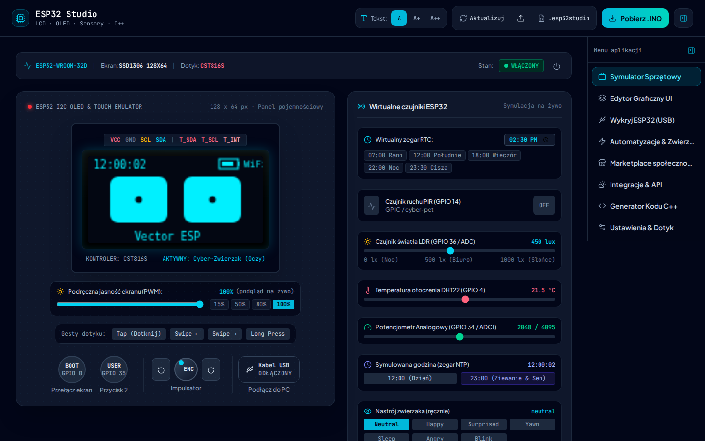
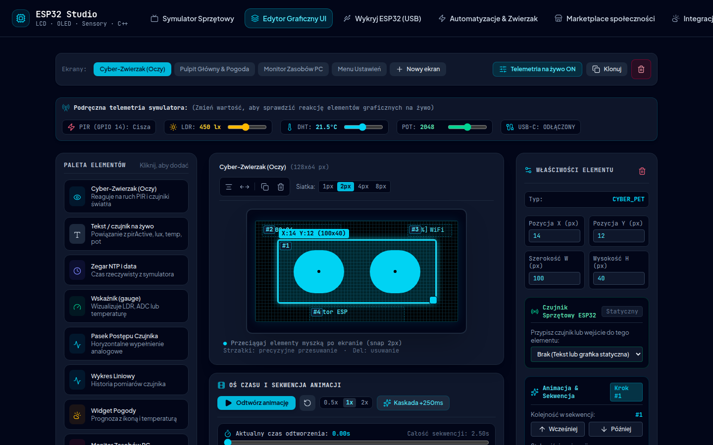
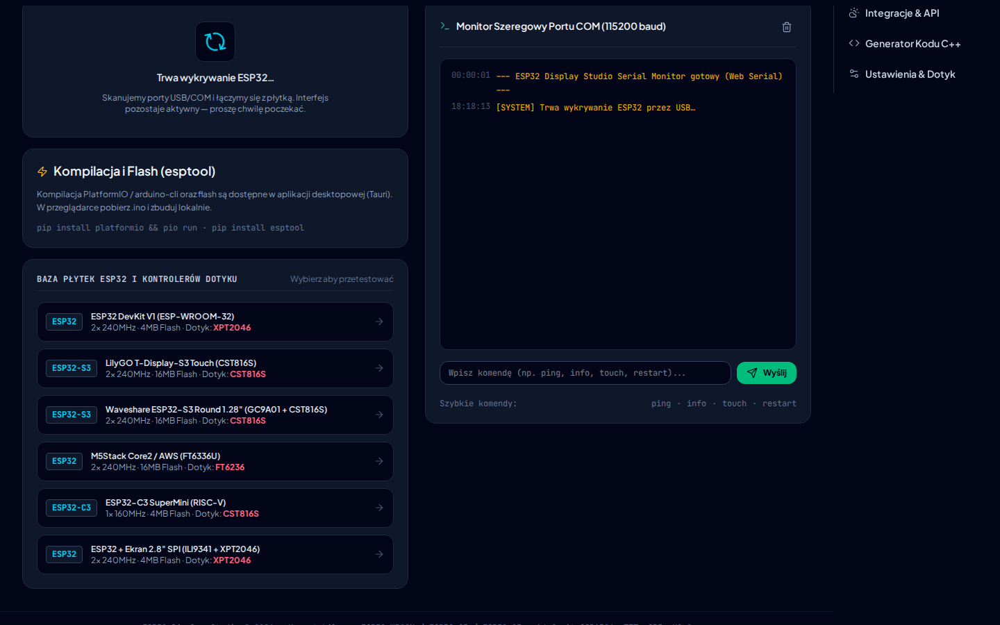
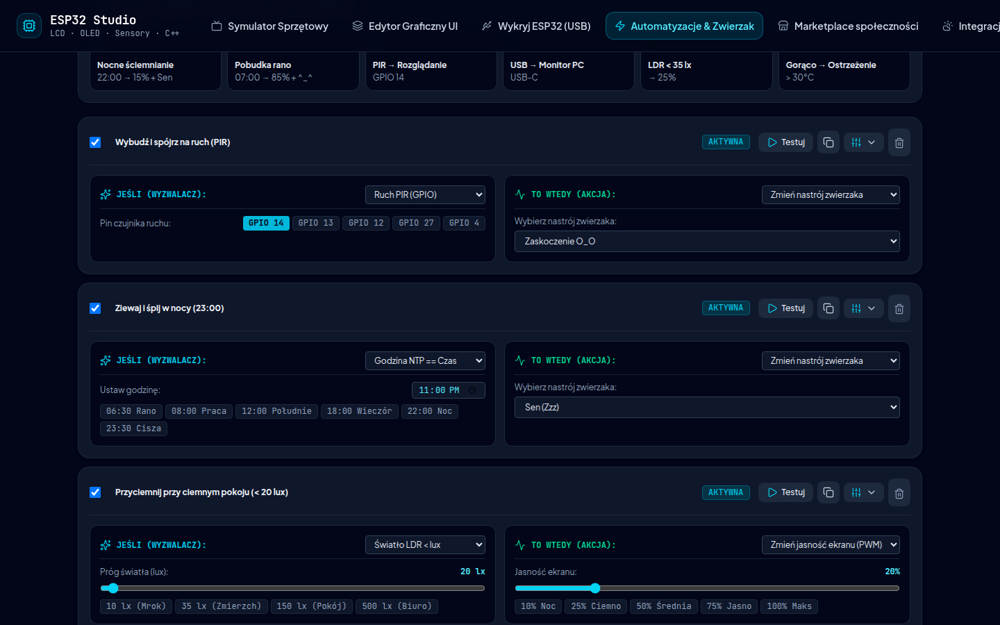
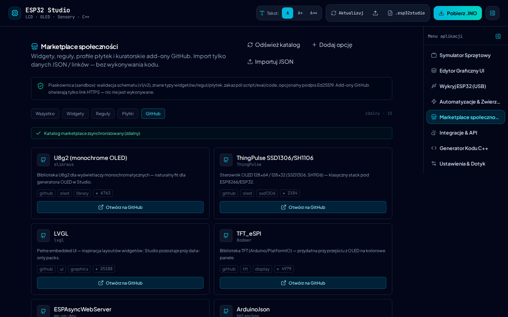
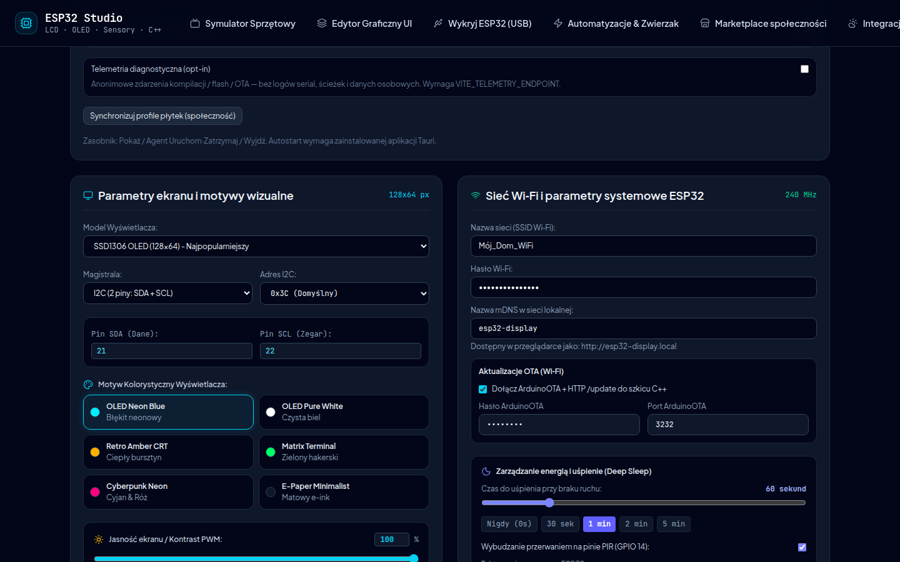
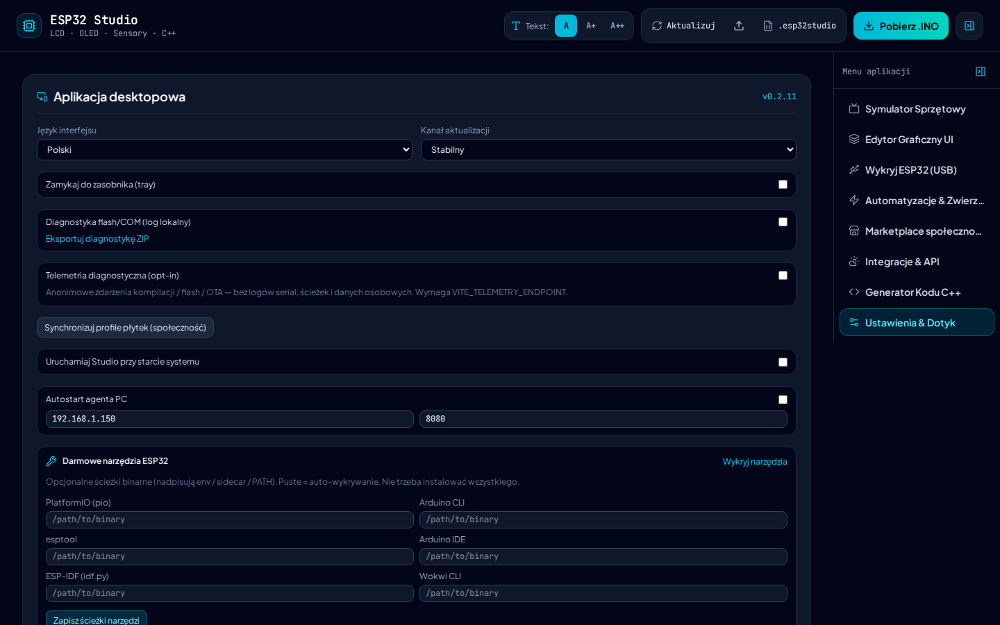
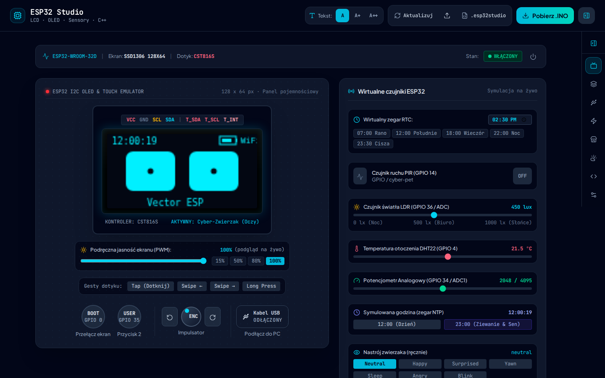

# Przewodnik użytkownika — ESP32 Display Studio

Krótki przewodnik po aplikacji **0.2.13**. Warstwy / IPC / env: [architecture.md](./architecture.md). Sterowniki, OTA, winget: dokumenty poniżej.

## Dwa tryby uruchomienia

| Tryb | Jak | Serial USB |
|------|-----|------------|
| **Przeglądarka** | `npm run dev` → [http://localhost:3000](http://localhost:3000) | Web Serial (Chrome / Edge / Brave) przez `src/platform/serial.ts` |
| **Desktop (Tauri 2)** | `npm run tauri:dev` lub instalator z Releases | Natywne `COMx` / `/dev/tty*` / `/dev/cu.*` (`nativeSerial` → Rust `serialport`) |

Desktop dodaje: Build → Flash → OTA, tray/autostart, auto-update, deep link `esp32studio://`, agent PC, diagnostykę ZIP, marketplace sandbox.

## Pierwsze kroki (przeglądarka)

1. Zainstaluj [Node.js 22 LTS](https://nodejs.org/), potem `npm install` i `npm run dev`.
2. Otwórz Chromium z Web Serial.
3. Zaprojektuj wyświetlacz w **Symulatorze** / **Edytorze UI**.
4. Podłącz ESP32 → **Wykryj ESP32 (USB)** → wybierz port.
5. Wyeksportuj kod w **Generatorze C++** (`.ino` + `platformio.ini`) albo zapisz projekt `.esp32studio`.

## Pierwsze kroki (Windows desktop)

1. Zainstaluj Studio z GitHub Releases (NSIS `.exe` zalecane) albo zbuduj lokalnie — [windows-installer.md](./windows-installer.md).
2. Podłącz płytkę; upewnij się, że w Menedżerze urządzeń jest `COMx` — [windows-drivers.md](./windows-drivers.md).
3. **Wykryj ESP32 (USB)** — backend `Native COM`.
4. **USB → Build → Flash** — pierwszy build może długo ściągać platformę espressif32.
5. Bez `pio` w PATH: [sidecar PlatformIO](./windows-sidecar-pio.md).

Linux / macOS: [desktop-unix.md](./desktop-unix.md).

## Główne funkcje

- **Symulator sprzętowy** — OLED/LCD, sensory, GPIO  
- **Edytor UI** — widgety, animacje, sekwencje ekranów  
- **Automatyzacje / cyber-zwierzak** — PIR, A3144, HC-SR04, czas, dotyk, USB, relay/servo  
- **Marketplace** — widget/rule packs, **board packs**, curated **GitHub add-ons** + formularz „Dodaj opcję” (sandbox bez wykonywania kodu) — [marketplace-github-addons.md](./marketplace-github-addons.md)  
- **USB** — **Wykryj ESP32** z nieblokującym banerem oczekiwania; po detekcji **graficzna mapa pinów** (WROOM-32) z programowaniem ról (A3144, DHT22, DS18B20, HC-SR04, servo, relay, WS2812, L298N, SPI/I²C)  
- **Nawigacja** — na desktopie (`lg+`) zwijane **menu aplikacji po prawej**; stan zapamiętany w `localStorage`  
- **Tooling** — detekcja PlatformIO / Arduino CLI·IDE / esptool / ESP-IDF / Wokwi + override ścieżek w Ustawieniach desktop — [esp32-tooling-integrations.md](./esp32-tooling-integrations.md); na Windows probe’y i build/flash **bez migających okien CMD** (0.2.13+) — [windows-desktop.md](./windows-desktop.md)  
- **Integracje** — pogoda (Open-Meteo itd.), **Monitor PC** (CPU/RAM/dysk)  
- **Generator C++** — Arduino / PlatformIO + mapa pinów / wiring cheat-sheet dla przypisanych peryferiów  
- **i18n** — PL / EN (**Ustawienia → Aplikacja desktopowa → Język interfejsu**; w przeglądarce ten sam przełącznik w panelu Desktop)

### Podgląd UI (screenshoty)

Zrzuty z web UI (locale **PL**, motyw dark cyan/slate):

## Build, Flash, OTA (desktop)

1. Skonfiguruj wyświetlacz, Wi‑Fi (dla OTA) i automatyzacje.  
2. W zakładce USB użyj **Build** / **Flash** / **Build + Flash** (toolchain: PATH lub [sidecar PIO](./windows-sidecar-pio.md); override `ESP32_STUDIO_PIO`).  
3. **OTA Wi‑Fi**: po pierwszym wgraniu USB użyj mDNS (`_arduino._tcp` / `_http._tcp`) lub IP — [windows-ota.md](./windows-ota.md).  
4. Zamknij Serial Monitor przed flashowaniem USB (port musi być wolny dla `esptool`).

## Ustawienia desktop

**Ustawienia → Desktop:**

| Opcja | Opis |
|-------|------|
| Język interfejsu | Polski / English |
| Zamykaj do zasobnika | Okno ukrywa się w tray |
| Autostart Studio / agenta PC | Start z systemem |
| Kanał aktualizacji | Stabilny (`latest.json`) / Beta (`latest-beta.json`) |
| Diagnostyka flash/COM | Lokalny log + eksport ZIP |
| Synchronizuj profile płytek | Community catalog VID:PID |
| Telemetria diagnostyczna | **Opt-in**, domyślnie off — [telemetry.md](./telemetry.md) |

## Projekty i deep link

- Zapis / otwarcie: plik **`.esp32studio`**  
- Protokół: `esp32studio://open?path=…`, `esp32studio://flash?path=…`  
- Szczegóły: [windows-deep-link.md](./windows-deep-link.md)

## Agent PC

W desktopie: **Integracje → Monitor PC → Start/Stop**.  
Samodzielnie: `tools/pc-agent` — [windows-pc-agent.md](./windows-pc-agent.md).

## Gdy coś nie działa

| Objaw | Co sprawdzić |
|-------|----------------|
| Brak portu COM | Sterownik CH340 / CP210x / Espressif |
| Flash fails | Port wolny, offset chipa, BOOT+RESET |
| OTA nie znajduje hosta | Ta sama sieć Wi‑Fi, mDNS UDP 5353, pierwsze flash USB |
| SmartScreen | Oficjalny Release + [windows-smartscreen.md](./windows-smartscreen.md) |
| Support | Eksport ZIP diagnostyki — [windows-diagnostics.md](./windows-diagnostics.md) |

Powrót: [indeks docs](./README.md).
